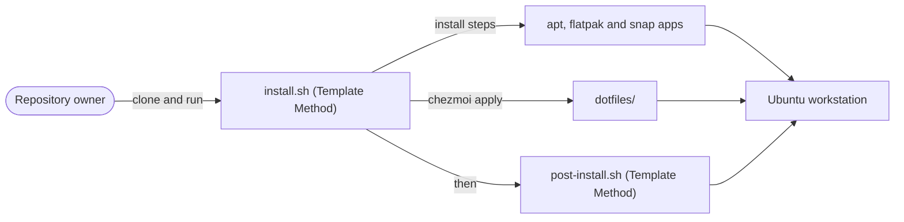

# Diagrams

Standing architecture diagrams for this repository, per the diagram standard in
the coding-agent standards hub. The System diagram lives here; deeper levels
live beside the scope they depict and get a row below. Verdicts for every scope
live as `[Architecture]` tags in code files and folder `AGENTS.md` files; this
table carries none.

## System

The owner clones the repo and runs `install.sh`; `post-install.sh` finishes the
interactive shell setup afterward.

## Registry

| Scope                  | Level     | Type      | Where                                     |
| ---------------------- | --------- | --------- | ----------------------------------------- |
| `.`                    | System    | Context   | this file                                 |
| `tests/`               | Component | Flowchart | `tests/README.md#test-strategy`           |

## Levels not diagrammed

- **Setup**: `setup/` is one file per app and the phase order is already stated
  in `setup/install.sh`. A diagram would repeat the source.
- **Skills**: `.agents/skills/` is a flat set of manifests discovered by their
  frontmatter `description`; there is no selection flow to draw.
- **Reports and dotfiles**: small, flat scopes with no structure worth showing.
