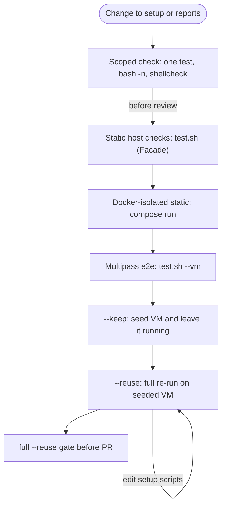

# Test suite

The tiers are cumulative: each adds isolation and runs only after the one below
it is green. `tests/test.sh` (Facade) is the single entry point for the static
and e2e tiers, and it also discovers every `*-test.sh` file under `tests/`.

## Test strategy

Scoped checks run while editing. The full gate runs before the first local
review, and again before a pull request only when review feedback changed code.
`--keep` and `--reuse` are valid only with `--vm`, and the per-worktree VM lock
allows one e2e run per checkout at a time. The host static tier sources library
scripts, so use the Docker-isolated tier for an untrusted checkout.
