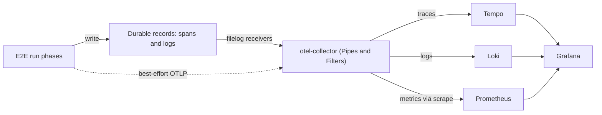

# E2E observability

The local stack turns an e2e run into traces, correlated logs and metrics. Start
it after a run to browse the durable records, or before a run to add live
forwarding from the VM.

## Data flow

The collector reads `/records` from a read-only mount, so records stay complete
when the stack starts late or the live OTLP edge is unreachable. Tempo answers
trace-to-log lookups through Loki, and Prometheus scrapes the collector's
metrics endpoint and Tempo. Start the stack with
`docker compose -f tests/observability/compose.yml up -d`; Grafana is at
`http://localhost:3000` (`admin`/`admin`).

The record contract and the chosen feature scope are in
[decision 0009](../../docs/decisions/0009-e2e-run-observability.md) and
[decision 0012](../../docs/decisions/0012-local-grafana-feature-scope.md).
